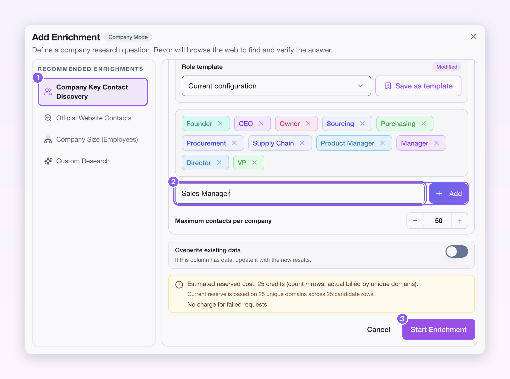
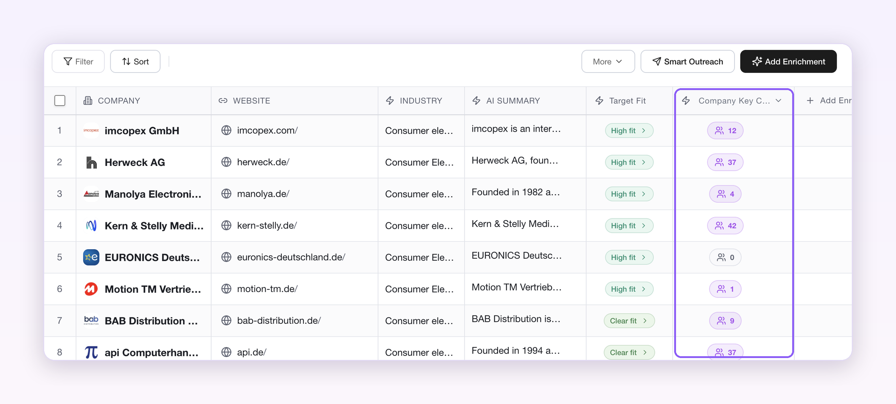
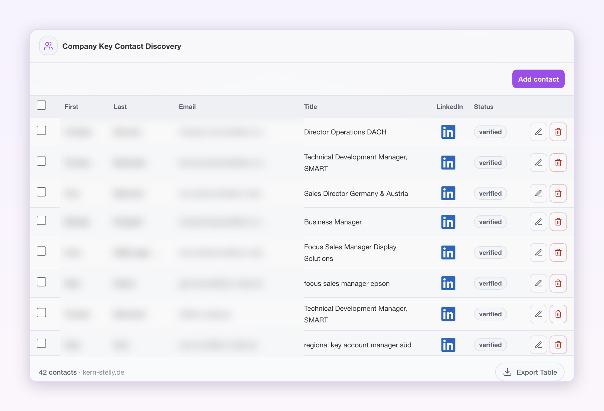
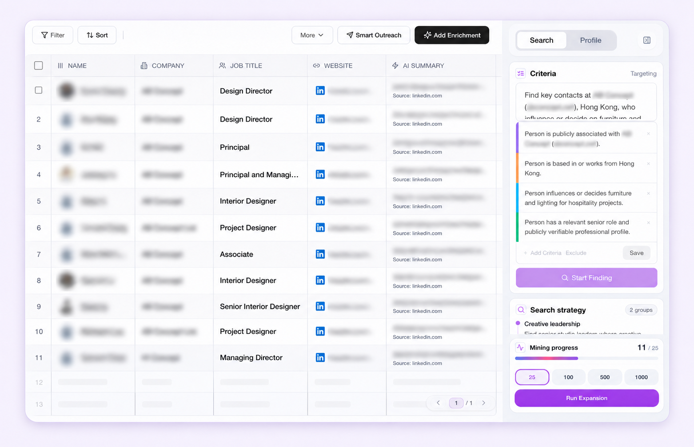

## Before you start

- **A Revor AI account**  [https://revor.ai/auth/signin](https://revor.ai/auth/signin)
- **Credits on your account** Make sure you have credits available.

In **Targets**, choose one of three ways to build your prospect list:

- **Find companies** — Use this when you know what types of companies you want to target. Describe their industry, location, size, or buying signals.
- **Find people** — Use this when you know who you want to reach. Describe their job titles, roles, and the types of companies they work for.
- **Upload a customer list** — Use this when you already have a list of companies or contacts you want to reach.

## <Icon icon="buildings" color="#8B5CF6" /> **Find companies**

Use **Companies** when you know what types of companies you want to target.

Describe your ideal customers, including their industry, location, size, or buying signals.

For example:

> Find consumer electronics distributors in Germany with 50 to 500 employees that are currently hiring for purchasing roles.

Click **Add Enrichment** to add more information to your company list. 

Choose what you want to find:

- **Company Key Contact Discovery** — Find people in the roles you want to reach.
- **Official Website Contacts** — Find contact information published on each company’s official website.
- **Company Size (Employees)** — Find each company’s employee count.
- **Custom Research** — Ask a specific question about each company. Revor browses the web to find and verify the answer.

To find key contacts, select **Company Key Contact Discovery**, enter a job title such as **Sales Manager**, and click **Add**. Then click **Start Enrichment**.

Revor finds people with those titles at each company on your prospect list and adds them to the same list.

Click a company's **Company key contact** **Discovery** field to see its contacts, including names, emails, titles and LinkedIns.

## <Icon icon="people-group" /> **Find people**

Use **People** to find relevant contacts at a specific company or people with particular job titles or responsibilities across an industry.

Describe who you want to reach, including the company or industry, location, and relevant roles or responsibilities.

Results may include current employees and other people with publicly documented connections to your target company.

## <Icon icon="table-list" /> **Upload a customer list**

Use **Upload your list** when you already have customers or contacts you want to reach. For example:

- **Follow up after a trade show** — Upload the contacts you collected from business cards and organized in a spreadsheet.
- **Reconnect with existing customers** — Upload your customer list to restart conversations and explore new opportunities.
- **Fill in missing information** — Upload a list of target companies and use **Add Enrichment** to find key contacts or other details.

Once your list is ready, assign a Revor AI employee to reach out to your contacts automatically.

<Check>
  Whichever method you choose, Revor organizes the results into a **Prospect List**.
</Check>
