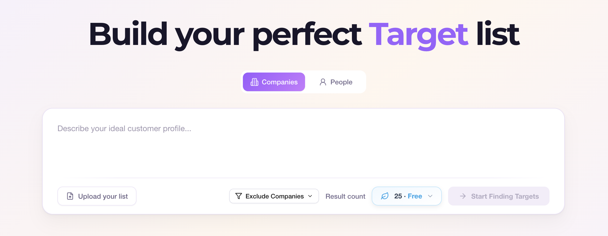
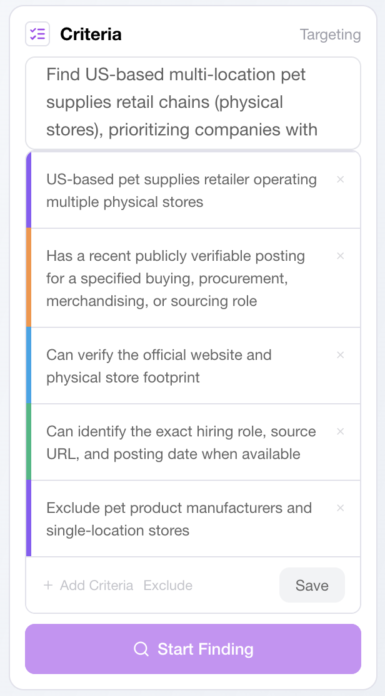

<Frame>
  
</Frame>

在 **Targets** 中，你如何描述想找的公司，是影响结果最重要的输入。

抓住真实客户共同特征的描述，比罗列所有细节的描述更能找到契合的公司。

本指南介绍如何描述有采购意向的公司。

## 描述中应包含什么

好的描述包含两部分：你的理想客户是谁（**ICP**），以及哪些迹象表明对方现在可能需要你的产品（**购买信号**）。

| **组成部分** | **描述内容** | **示例** |
| --- | --- | --- |
| 公司类型 | 公司在产业链中的角色 | 分销商、制造商、进口商 |
| 行业/产品 | 公司销售或生产什么 | 消费电子、宠物保健品 |
| 地区 | 公司在哪里经营 | 美国、德国、东南亚 |
| 公司规模 | 公司有多大 | 50 到 200 名员工 |
| 购买信号 | 哪些迹象表明当前有需求 | 正在招聘采购岗位 |

不需要每次都写全所有部分。通常写清公司类型、行业和地区就足够开始；需要缩小范围时，再加上规模和购买信号。

## 添加购买信号

购买信号是 Revor 的结果区别于普通企业数据库的关键。

你得到的不是所有符合画像的公司，而是当下显示出真实需求的公司。

合适的信号取决于你卖什么。

问问自己：**公司的哪种变化会让它需要我的产品？**

> 例如，一家消费电子供应商专找已经在销售竞品的分销商，因为这些分销商已经证明自己能卖好同类产品。

**_常见的购买信号包括：_**

<Columns cols={2}>
  <Card title="招聘" icon="handshake-alt">
    正在招聘采购岗位，或与你的产品相关的岗位
  </Card>

  <Card title="**管理层变动**" icon="anchor">
    新任高管或部门负责人，可能会重新评估供应商
  </Card>
</Columns>

<Columns cols={2}>
  <Column>
    <Card title="法规" icon="file-alt">
      受到新法规影响
    </Card>
  </Column>
  <Column>
    <Card title="**公开活动**" icon="archway">
      发布招标、参加展会
    </Card>
  </Column>
</Columns>

<Columns cols={2}>
  <Column>
    <Card title="**业务变化**" icon="exchange">
      更换系统、推进数字化，或宣布新的合作伙伴关系

      选择会留下公开痕迹的信号，例如招聘信息、新闻稿或公开报告，方便 Revor 核实。

      挑选一到两个与购买你的产品关系最密切的信号。
    </Card>
  </Column>
  <Column>
    <Card title="**竞品**" icon="hand-back-fist">
      已经在销售竞品的分销商，或正在使用竞品但仍在寻找更多供应商的公司
    </Card>
  </Column>
</Columns>

## Revor 如何理解你的描述

点击 **Start Finding Targets** 后，Revor 会把你的描述拆分成多个独立条件，例如行业、地区和公司规模，并逐一核对每家公司。你可以在名单右侧的 **Criteria** 面板中查看这些条件。

<Frame>
  
</Frame>

描述中的每一部分都会成为 Revor 需要核实的条件。描述含糊，Revor 能核对的内容就少；描述具体，Revor 才能过滤掉不符合的公司。

## 从含糊到具体

| 太含糊 | 较好 | 最佳 |
| --- | --- | --- |
| 查找电子公司。 | 查找德国的消费电子分销商。 | 查找德国员工规模 50 到 500 人、正在招聘采购岗位的消费电子分销商。 |

第一个描述没有说明公司类型和地区，结果会很宽泛。最后一个描述写明了公司类型、行业、地区、规模和一个购买信号，每个结果都会按这五个条件核对。

## 更多技巧

<Tip>
  **把握合适的详细程度**
</Tip>

描述并不是越详细越好。你加的每个条件，无论是 ICP 还是购买信号，都是公司必须满足的又一项要求。

条件太少，结果宽泛且不够准确；条件太多，结果可能很少，搜索也可能耗时更久。

先写最重要的条件，如果结果仍然太宽泛，再逐步添加。

<Tip>
  **可以使用任何语言**
</Tip>

Revor 支持任何语言的搜索描述，用你最习惯的语言写即可。

<Tip>
  **描述你的客户，而不是你的产品**
</Tip>

想想你的客户是谁，而不是他们从你这里买什么。

例如，一家为游乐场所销售防滑袜的公司，最初搜索的是： `查找需要防滑袜的德国公司。`

很少有公司能通过“需要什么袜子”被识别出来，所以结果有限，也不总是相关。之后这家公司改为描述自己的客户： `查找德国提供蹦床等项目的室内游乐场。`

结果准确了很多，因为提供蹦床的室内游乐场正是需要防滑袜的场所。
