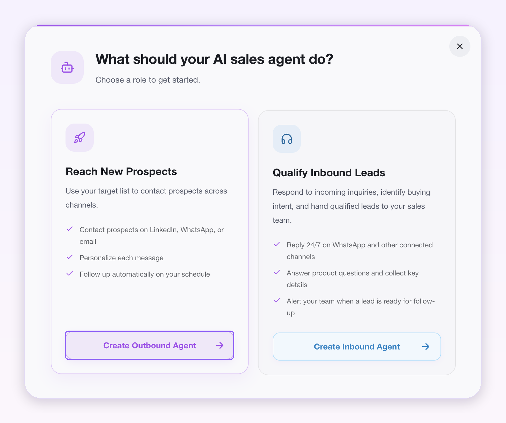
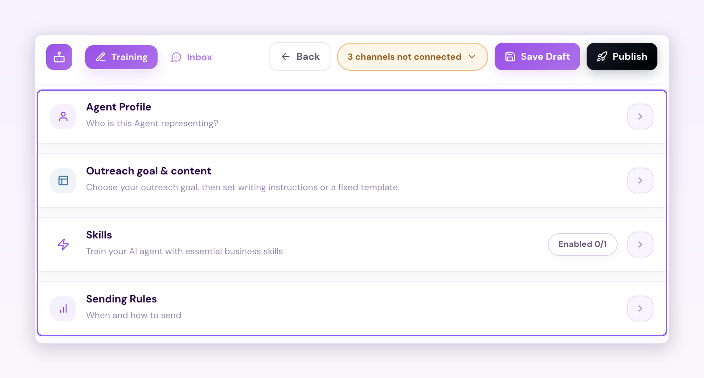
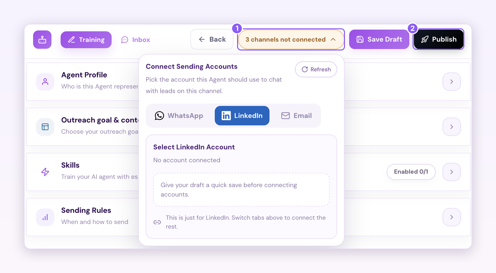
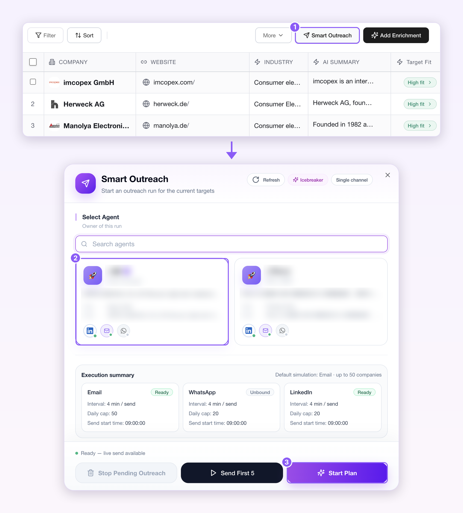

## 开始之前

以下内容会在设置过程中用到，提前准备好可以一次完成所有步骤。

- **一个 Revor AI 账户**  [https://revor.ai/auth/signin](https://revor.ai/auth/signin)
- **至少一个已连接的渠道**
- **你的公司信息** - 公司官网。 - AI 员工所代表人员的 LinkedIn 主页链接。
- **账户中有可用积分** 请确认账户中有可用积分。

## 设置步骤

<Steps>
  <Step title="**训练并发布主动开发 AI 员工**">
    <Frame>
      
    </Frame>

    进入 **Agents** > **Train agent** > **Create agent** > **Create outbound agent**。在弹窗中输入公司官网和你的个人 LinkedIn 链接，然后点击 **Start**。

    <Frame>
      
    </Frame>

    然后完成以下四个部分：

    - **Agent profile**：AI 员工代表谁。
    - **Outreach goal & content**：选择开发目标，再设置写作指令或固定模板。
    - **Skills**：为 AI 员工配置必要的业务技能。
    - **Sending rules**：消息的发送时间和方式。

    <Frame>
      
    </Frame>

    最后，在 **Connect sending accounts** 中选择 AI 员工用于触达的已连接渠道，点击 **Publish**。
  </Step>
  <Step title="**将 AI 员工指派给潜客名单**">
    <Frame>
      
    </Frame>

    回到你创建的潜客名单，点击 **Smart Outreach**。

    选择已发布的 AI 员工，点击 **Start Plan**。

    AI 员工会通过已连接的渠道，逐一触达名单中的联系人。

    <Tip>
      打开 **Opportunities** 查看开发进展。

      

      如需查看 AI 员工与每位联系人的对话，进入 **Agent** > **My agent**，选择 AI 员工，点击 **Inbox**。

      
    </Tip>
  </Step>
</Steps>

<Check>
  现在，你的主动开发 AI 员工会替你触达名单中的每一位潜客，并用个性化消息开启每段对话。
</Check>
