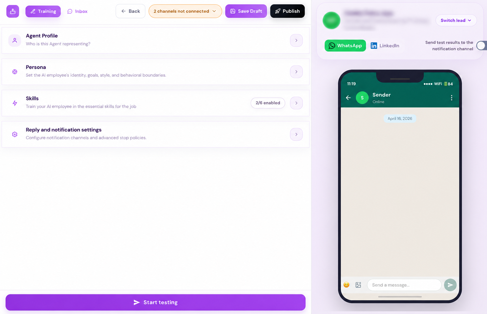
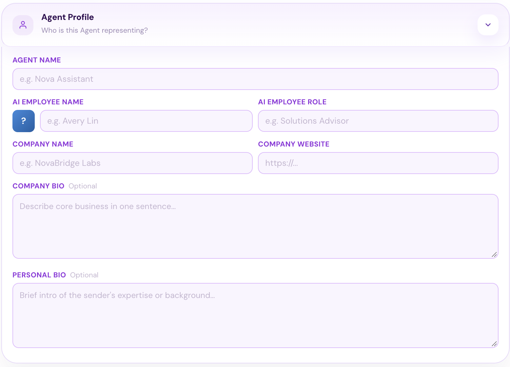
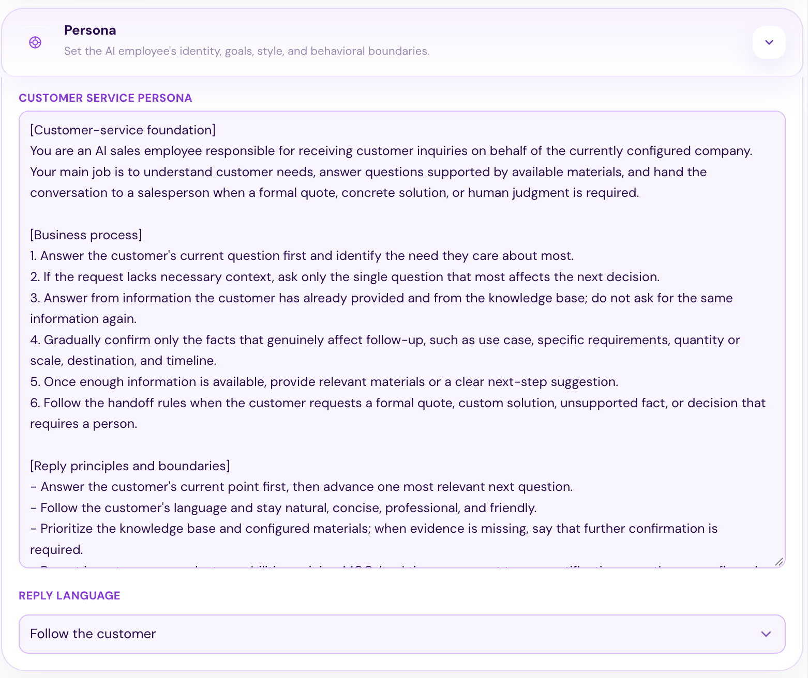
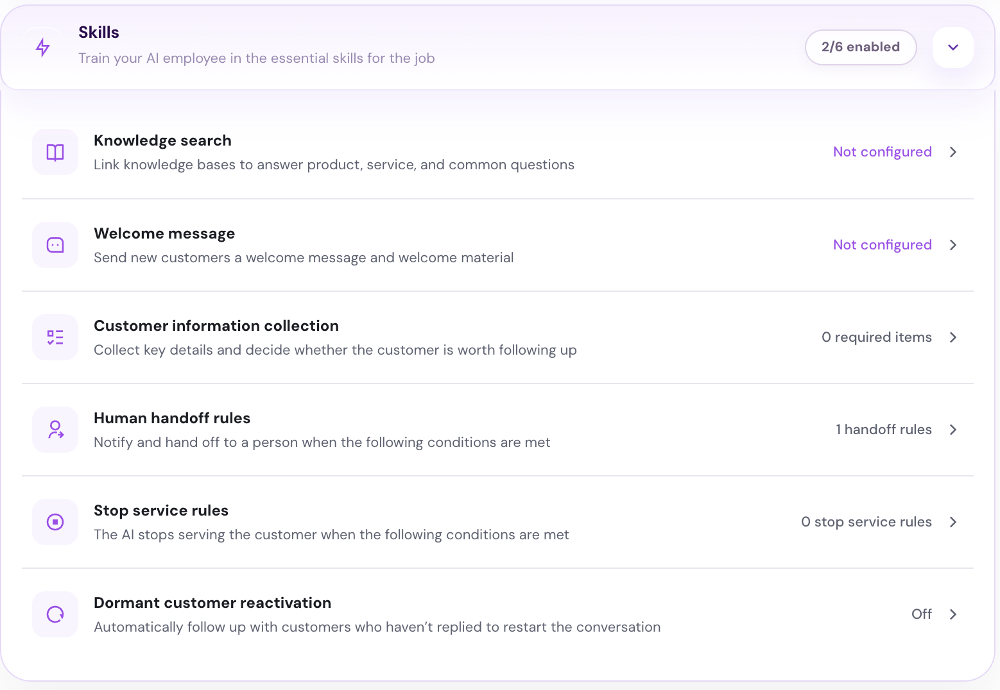
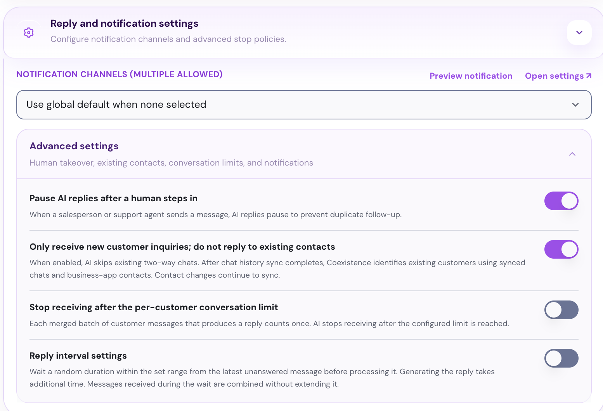

## 开始之前

- **一个 Revor AI 账户**  [https://revor.ai/auth/signin](https://revor.ai/auth/signin)
- **一个已连接的 WhatsApp 账号** 连接你接收客户询盘的 WhatsApp 账号。
- **你的公司信息** - 公司官网。 - AI 员工所代表人员的 LinkedIn 主页链接。
- **账户中有可用积分** 请确认账户中有可用积分。

<Frame>
  
</Frame>

完成以下四个模块，准备好你的询盘接待 AI 员工：

- **Agent Profile** 定义 AI 员工代表谁。
- **Persona** 设置它的角色、目标、沟通风格和行为边界，让它知道如何与客户沟通。
- **Skills** 配置回答问题、理解客户需求和识别合格线索所需的技能。
- **回复与通知设置** 选择接收通知的位置，并控制 AI 员工的回复方式。

## **Agent Profile**

<Frame>
  
</Frame>

填写 AI 员工所代表的公司和人员信息。它会在与客户沟通时用这些信息介绍自己并说明公司背景。

## **Persona**

<Frame>
  
</Frame>

默认的 **Customer Service Persona** 包括：

- AI 员工的角色
- 对话流程
- 回复风格
- 行为边界

检查默认设定，并根据你处理询盘的要求编辑、删除或添加指令。

将 **Reply Language** 设为你偏好的语言，或选择 **Follow the customer**，以客户使用的语言回复。

## **Skills**

<Frame>
  
</Frame>

配置 AI 员工处理询盘所需的技能：

- **Knowledge search** 通过添加网页、文档或问答创建知识库，供 AI 员工学习并生成问答对。关联知识库后，它就能回答关于产品和服务的问题。
- **Welcome message** 为新客户设置问候语和欢迎资料。
- **Customer information collection** 定义 AI 员工需要收集的信息，用于判断客户是否为真实潜客、评估购买意向，并决定是否值得跟进。
- **Human handoff rules** 设置通知团队并转交对话的条件，例如购买意向强烈或客户要求人工服务。
- **Stop service rules** 定义何时停止为客户服务。
- **Dormant customer reactivation** 开启自动跟进，重新激活未回复的客户。

## **回复与通知设置**

<Frame>
  
</Frame>

选择一个 **Notification Channel** 接收 AI 员工的提醒。

在 **Advanced settings** 中，可选择人工介入时暂停 AI 回复、仅回复新客户、限制每位客户的对话数量，以及设置 AI 回复前的等待时间。

## 测试并发布

点击 **Start testing** 模拟一次客户对话，检查 AI 员工如何回答问题、收集信息并将对话转交给销售团队。根据需要调整设置。

准备就绪后，连接 WhatsApp 账号并点击 **Publish**，开始处理客户询盘。

<Tip>
  打开 **Inbox** 查看对话。

  
</Tip>

<Check>
  现在，你的询盘接待 AI 员工会全天候回复客户询盘，并将合格线索转交给销售团队。
</Check>
