Use these Revor AI logo files when you need to identify the product in a partner listing, article, presentation, or integration. Choose the version that fits your layout and background, and use the linked PNG asset without altering it.

## Logo files

Choose a preview below to open its full-size PNG. The horizontal logo includes the Revor symbol and wordmark. The square mark fits compact spaces; use the horizontal logo when the product name needs to be visible.

### Horizontal logo

<Columns cols={3}>
  <Card title="Color on light" href="/images/brand/revor-ai-horizontal-color.png" cta="Open PNG">
    

  

  </Card>

  <Card title="Black on light" href="/images/brand/revor-ai-horizontal-black.png" cta="Open PNG">
    

  

  </Card>

  <Card title="White on dark" href="/images/brand/revor-ai-horizontal-white.png" cta="Open PNG">
    

  

  </Card>
</Columns>

### Square mark

<Columns cols={3}>
  <Card title="Color on light" href="/images/brand/revor-ai-stacked-color.png" cta="Open PNG">
    

  

  </Card>

  <Card title="Black on light" href="/images/brand/revor-ai-stacked-black.png" cta="Open PNG">
    

  

  </Card>

  <Card title="White on dark" href="/images/brand/revor-ai-stacked-white.png" cta="Open PNG">
    

  

  </Card>
</Columns>

## App icons and separate components

Use an app icon for a product listing, launcher, or profile image. These previews show the two versions with a solid background.

<Columns cols={2}>
  <Card title="Purple on white" href="/images/brand/revor-ai-app-icon-purple-on-white.png" cta="Open PNG">
    
  </Card>

  <Card title="White on purple" href="/images/brand/revor-ai-app-icon-white-on-purple.png" cta="Open PNG">
    
  </Card>
</Columns>

For a transparent background, open the [purple](/images/brand/revor-ai-app-icon-purple-transparent.png), [black](/images/brand/revor-ai-app-icon-black-transparent.png), or [white](/images/brand/revor-ai-app-icon-white-transparent.png) app icon. The [Revor symbol](/images/brand/revor-ai-symbol.png) and [Revor wordmark](/images/brand/revor-ai-wordmark.png) are also available separately. Use the complete horizontal logo when you need both together.

## Usage guidelines

- Keep the logo's original proportions and leave clear space around it.
- Choose a color or black version on a light background and the white version on a dark background.
- Do not stretch, crop, rotate, recolor, or add effects to the supplied artwork.
- Do not imply Revor AI endorses or sponsors another product or organization without approval.

## About Revor AI

Revor AI helps B2B teams discover prospects, research companies, and engage contacts through connected channels.

For a vector file, co-branding request, or a use not covered here, [contact Revor support](mailto:support@revor.ai).
