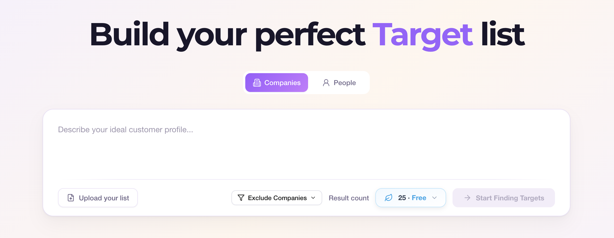
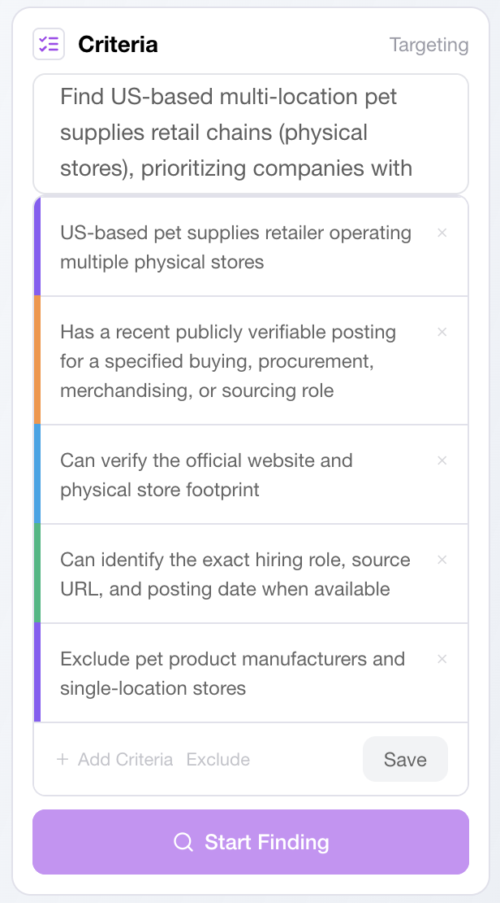

<Frame>
  
</Frame>

How you describe the companies you want is the most important input in **Targets**. 

A description that captures what your real customers have in common finds better-fit companies than one that lists every possible detail. 

This guide shows how to describe companies that are ready to buy.

## What to include

A good description covers two things: who your ideal customer is (your **ICP**) and what shows they may need your product right now (**buying signals**).

| **Part** | **What it describes** | **Example** |
| --- | --- | --- |
| Company Type | The role the company plays | distributors, manufacturers, importers |
| Industry/Product | What the company sells or make | consumer electronics, pet supplements |
| Location | Where the company operates | America, Germany, Southeast Asia, |
| Company Size | How big the company is | 50 to 200 employees |
| Buying Signals | What suggests a current need | Hiring for purchasing roles |

You don't need every part in every description. Company type, industry, and location are usually enough to start; add size and buying signals to narrow the results.

## Add buying signals

Buying signals are what make Revor's results different from a plain company database. 

Instead of every company that fits your profile, you get the ones showing signs of a real need today. 

The right signals depend on what you sell. 

Ask yourself: **what change in a company's situation would make it need my product?** 

> For example, one consumer electronics supplier looks for distributors that already carry a competitor's products, because those distributors have proven they can sell products like theirs.

**_Common types of buying signals include:_**

<Columns cols={2}>
  <Card title="Hiring" icon="handshake-alt">
    recruiting for purchasing roles, or for roles related to your product
  </Card>

  <Card title="**Leadership changes**" icon="anchor">
    a new executive or department head who may review suppliers
  </Card>
</Columns>

<Columns cols={2}>
  <Column>
    <Card title="Regulation" icon="file-alt">
      being affected by new rules
    </Card>
  </Column>
  <Column>
    <Card title="**Public activity**" icon="archway">
      issuing tenders, attending trade shows
    </Card>
  </Column>
</Columns>

<Columns cols={2}>
  <Column>
    <Card title="**Business changes**" icon="exchange">
      switching systems, going digital, or announcing new partnerships

      Choose signals that leave a public trace, such as job postings, press releases, or published reports, so Revor can verify them. 

      Pick the one or two signals most closely tied to buying your product.
    </Card>
  </Column>
  <Column>
    <Card title="**Competitors**" icon="hand-back-fist">
      distributors that already carry a competitor's products, or companies that use a competitor's products but are still looking for more suppliers
    </Card>
  </Column>
</Columns>

## How Revor reads your description

When you click **Start Finding Targets**, Revor breaks your description into separate criteria, such as industry, location, and company size, and checks each company against them. You can see these criteria in the **Criteria** panel on the right side of your list.

<Frame>
  
</Frame>

Each part of your prompt becomes something Revor verifies. A vague prompt gives Revor little to check, while a specific one lets it filter out companies that don't fit.

## From vague to specific

| Too vague | Better | Best |
| --- | --- | --- |
| Find electronics companies. | Find consumer electronics distributors in Germany. | Find consumer electronics distributors in Germany with 50 to 500 employees that are currently hiring for purchasing roles. |

The first description doesn't say what kind of company or where, so the results will be broad. The last one names the company type, industry, location, size, and a buying signal, so every result is checked against all five.

## More tips

<Tip>
  **Find the right level of detail**
</Tip>

More detail isn't always better. Every condition you add, whether it's part of your ICP or a buying signal, is one more thing a company has to match. 

With too few conditions, results are broad and less accurate. With too many, you may get very few results, or the search may take longer to finish. 

Start with the conditions that matter most, and add more only if the results are still too broad.

<Tip>
  **Write in any language**
</Tip>

Revor supports search prompts in any language, so you can write in the one you're most comfortable with.

<Tip>
  **Describe your customers, not your product**
</Tip>

Think about who your customers are, rather than what they buy from you. 

For example, a company that sells non-slip socks for play areas first searched for: `Find German companies that need non-slip socks.`

Few companies can be identified by the socks they need, so the results were limited and not always relevant. The company then described its customers instead: `Find indoor playgrounds in Germany that offer activities such as trampolines.`

The results became much more accurate, because indoor playgrounds with trampolines are exactly the businesses that need non-slip socks.
