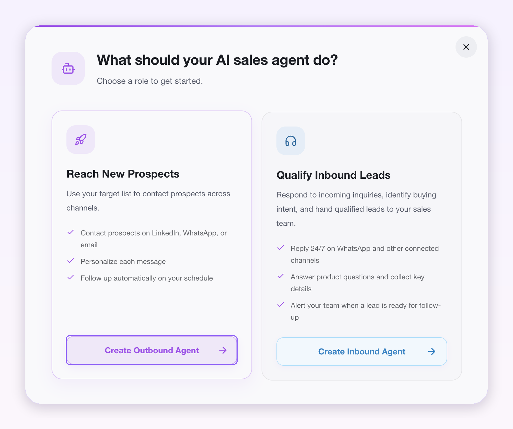
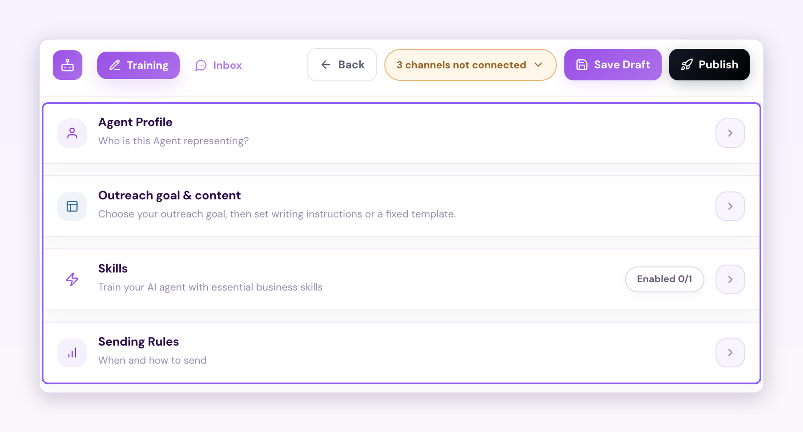
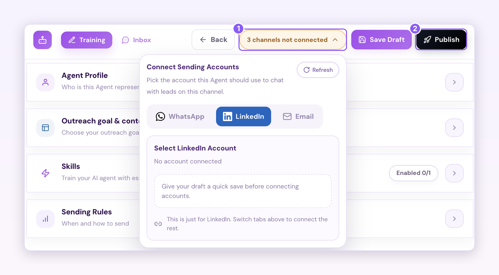
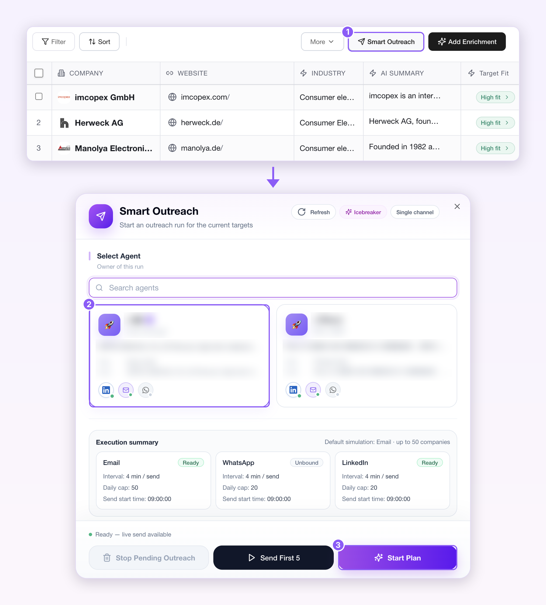

## Before you start

Each of the following comes up during setup. Prepare them first so you can go through the steps without stopping.

- **A Revor AI account**  [https://revor.ai/auth/signin](https://revor.ai/auth/signin)
- **At least one connected channel**
- **Your company information** - Your official company website. - The LinkedIn profile link of the person your AI employee represents.
- **Credits on your account** Make sure you have credits available.

## Setup steps

<Steps>
  <Step title="**Train and publish your outbound AI employee**">
    <Frame>
      
    </Frame>

    Go to **Agents** > **Train agent** > **Create agent** > **Create outbound agent**. In the dialog, enter your official company website URL and your personal LinkedIn URL, then click **Start**.

    <Frame>
      
    </Frame>

    Then complete four sections:

    - **Agent profile**: who your AI employee represents.
    - **Outreach goal & content**: choose your outreach goal, then set writing instructions or a fixed template.
    - **Skills**: train your AI employee with essential business skills.
    - **Sending rules**: when and how messages are sent.

    <Frame>
      
    </Frame>

    Finally, in **Connect sending accounts**, select the connected channels your AI employee will use to reach out, then click **Publish**.
  </Step>
  <Step title="**Assign your AI employee to a Prospect List**">
    <Frame>
      
    </Frame>

    Go back to the prospect list you built in the first two steps and click **Smart Outreach**. 

    Select the published AI employee you want to use, then click **Start Plan**. 

    Your AI employee starts reaching out to the contacts on the list one by one through your connected channels.

    <Tip>
      To see how your outreach is going, open **Opportunities**. 

      

      To read the conversations your AI employee has had with each contact, go to **Agent** > **My agent**, choose your AI employee, and click **Inbox**.

      
    </Tip>
  </Step>
</Steps>

<Check>
  You now have an outbound AI employee that reaches out to every prospect on your list for you, opening each conversation with a personalized message.
</Check>
