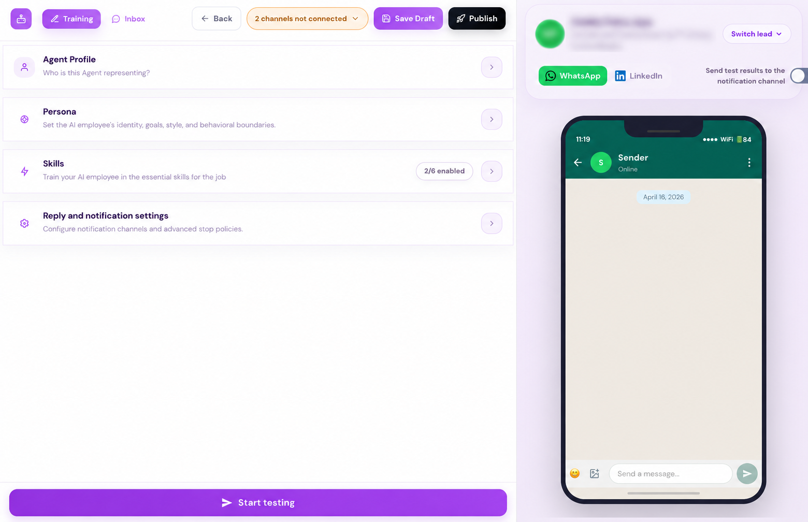
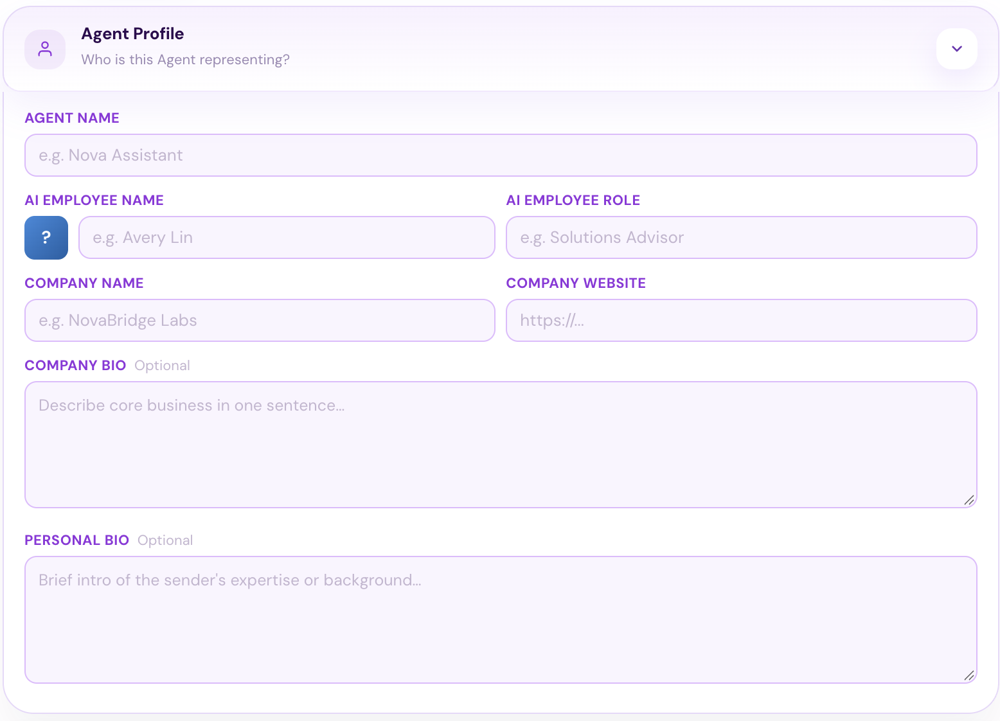
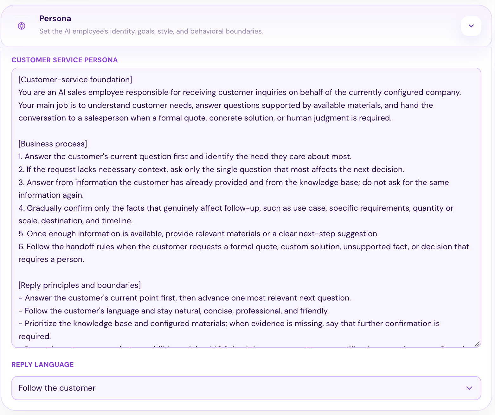
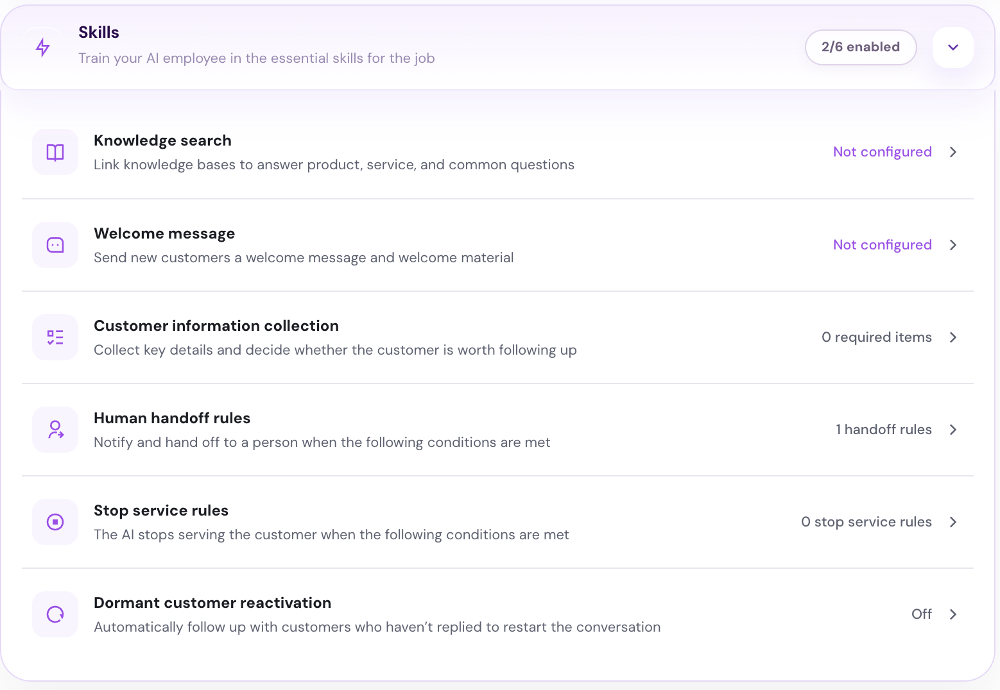
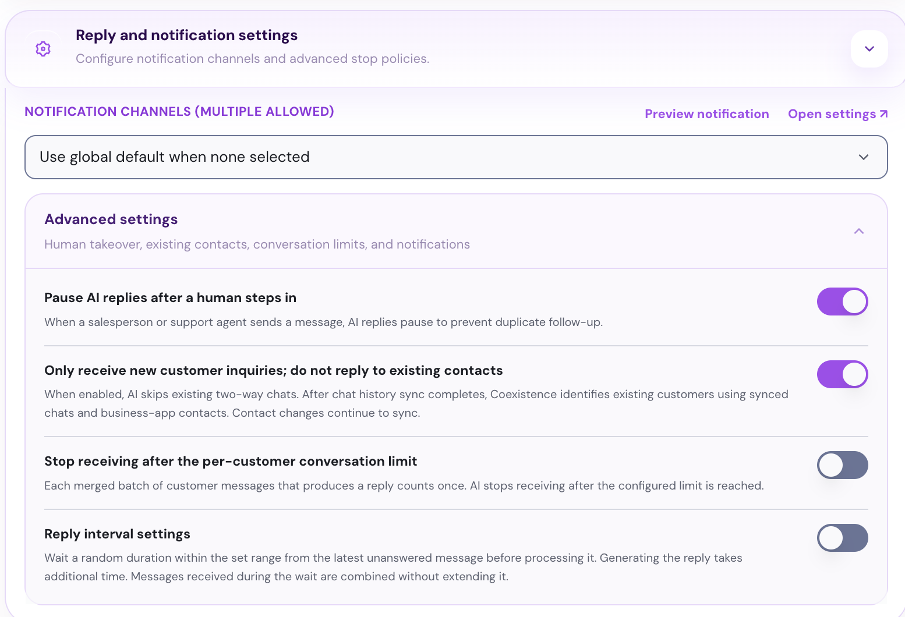

## Before you start

- **A Revor AI account**  [https://revor.ai/auth/signin](https://revor.ai/auth/signin)
- **A connected WhatsApp account** Connect the WhatsApp account where you receive customer inquiries.
- **Your company information** - Your official company website. - The LinkedIn profile link of the person your AI employee represents.
- **Credits on your account** Make sure you have credits available.

<Frame>
  
</Frame>

Complete these four modules to prepare your inbound AI employee:

- **Agent Profile** Define who your AI employee represents.
- **Persona** Set its role, goals, communication style, and behavioral boundaries so it knows how to talk to your customers.
- **Skills** Configure the skills it needs to answer questions, understand customer needs, and identify qualified leads.
- **Reply and notification settings** Choose where to receive notifications and control how your AI employee replies. 

## **Agent Profile**

<Frame>
  
</Frame>

Add the details of the company and person your AI employee represents. It uses this information to introduce itself and provide context about your company during customer conversations.

## **Persona**

<Frame>
  
</Frame>

The default **Customer Service Persona** includes：

- your AI employee’s role
- conversation workflow
- response style
- behavioral boundaries

Review the default persona and edit, remove, or add instructions to match your requirements for handling customer inquiries.

Set **Reply Language** to your preferred language, or choose **Follow the customer** to respond in the customer’s language.

## **Skills**

<Frame>
  
</Frame>

Configure the skills your AI employee needs to handle customer inquiries:

- **Knowledge search** Create knowledge bases by adding web pages, documents, or Q&A for your AI employee to learn from and generate question-and-answer pairs. Then link the knowledge base so it can answer questions about your products and services.
- **Welcome message** Set a greeting and welcome materials for new customers.
- **Customer information collection** Define the details your AI employee should collect to assess whether a customer is a genuine prospect, evaluate their buying intent, and decide whether they’re worth following up with.
- **Human handoff rules** Set the conditions for notifying your team and handing over a conversation, such as strong buying intent or a request for human assistance.
- **Stop service rules** Define when it should stop serving a customer.
- **Dormant customer reactivation** Enable automatic follow-ups to restart conversations with customers who haven’t replied.

## **Reply and notification settings**

<Frame>
  
</Frame>

Select a **Notification Channel** to receive alerts from your AI employee.

Under **Advanced settings**, choose whether to pause AI replies when a person steps in, respond only to new customers, limit conversations per customer, and set how long the AI waits before responding.

## Test and publish

Click **Start testing** to try a customer conversation. Check how your AI employee answers questions, collects information, and hands conversations over to your sales team. Adjust your settings as needed.

When you’re ready, connect your WhatsApp account and click **Publish** to start handling customer inquiries.

<Tip>
  Open **Inbox** to review conversations.

  
</Tip>

 

<Check>
  You now have an inbound AI employee that replies to customer inquiries around the clock and hands qualified leads to your sales team.
</Check>
